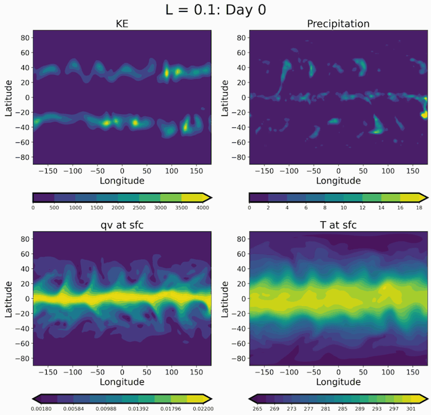
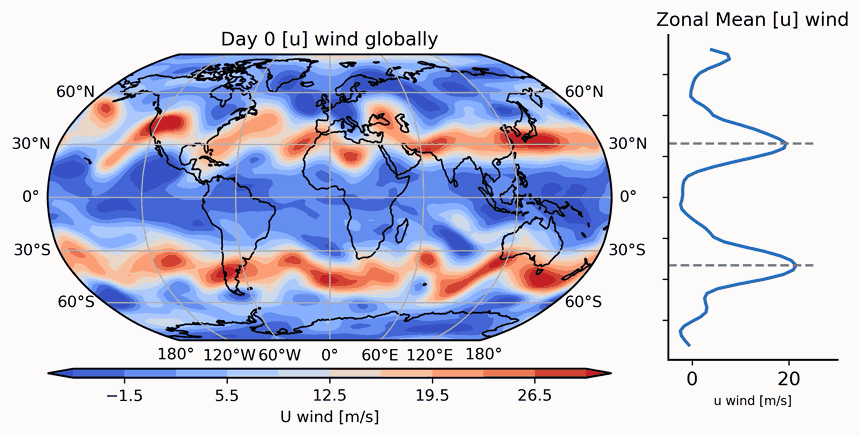
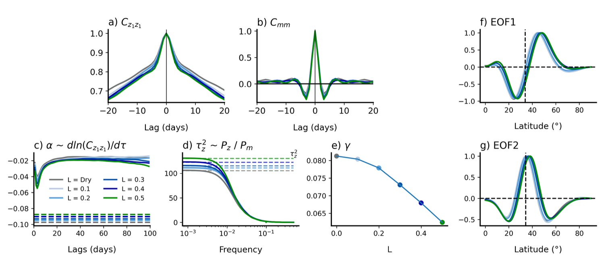

# Moist_Dycore

A moist idealized spectral GCM written in Julia. This repository documents how a
**large-scale precipitation (condensation) scheme** was added to a dry
Held–Suarez spectral dynamical core, and shows what the resulting model does.

The model code lives in [`spectral-gcm/`](spectral-gcm/).

<p align="center">
  
</p>
<p align="center">
  <em>A moist run with heating fraction 𝓛 = 0.1. Clockwise from top left: kinetic
  energy, precipitation, surface temperature, and surface specific humidity.</em>
</p>

## Contents

- [What this project adds](#what-this-project-adds)
- [The large-scale precipitation scheme](#the-large-scale-precipitation-scheme)
- [How it is wired into the model](#how-it-is-wired-into-the-model)
- [Running it](#running-it)
- [Results: annular mode and latent heating](#results-annular-mode-and-latent-heating)
- [References](#references)
- [Credits](#credits)

## What this project adds

The starting point is a dry primitive-equation spectral core forced by
Held–Suarez (1994) Newtonian relaxation and Rayleigh friction. That model has no
water vapour, so it cannot rain and has no latent heating.

Following the moist Held–Suarez test of Thatcher and Jablonowski (2016), whose
simple physics comes from Reed and Jablonowski (2012), we added:

| Component | What it does | Source file |
|---|---|---|
| Specific humidity `q` | New prognostic tracer, advected on the Gaussian grid | `src/Dynamics/Grid_Tracer_Transport.jl` |
| Large-scale condensation | Removes supersaturation, releases latent heat, rains | `src/Physics/Lscale_Cond.jl` |
| Surface fluxes | Bulk evaporation and sensible heating over an ocean surface | `src/Physics/PBL.jl` |
| Boundary-layer mixing | Implicit vertical diffusion of `u`, `v`, `T`, `q` | `src/Physics/PBL.jl` |
| Mass and water correction | Keeps dry-air mass fixed when water leaves the column | `src/Physics/Spectral_Physics_Interface.jl` |

All paths are relative to [`spectral-gcm/`](spectral-gcm/).

## The large-scale precipitation scheme

The scheme is a saturation adjustment. It has no cloud stage: any vapour above
saturation condenses and falls out as rain in the same time step, with no
re-evaporation on the way down.

**1. Saturation humidity.** At every grid cell, compute the saturation specific
humidity from the saturation vapour pressure $e_s(T)$:

```math
q_s(T,p)=\frac{\epsilon\, e_s(T)}{p-(1-\epsilon)\,e_s(T)},\qquad \epsilon=\frac{R_d}{R_v}
```

**2. Condensation.** Where $q > q_s$, the excess cannot simply be removed,
because condensation warms the air and warm air holds more vapour. Linearising
$q_s$ about the current temperature gives the amount that actually condenses:

```math
\Delta q=\frac{q_s(T,p)-q}{1+\mathcal{L}\,\dfrac{L_v}{c_p}\,\dfrac{\partial q_s}{\partial T}}
```

**3. Latent heating.** The condensed vapour heats the layer:

```math
\Delta T=-\mathcal{L}\,\frac{L_v}{c_p}\,\Delta q
```

**4. Precipitation.** The condensate from every layer is summed over the column
and leaves as surface precipitation (kg m⁻² s⁻¹):

```math
P=-\frac{1}{\Delta t}\sum_k \Delta q_k\,\frac{\Delta p_k}{g}
```

These are Eqs. (1)–(5) of Thatcher and Jablonowski (2016), which take the
scheme from Reed and Jablonowski (2012), with two differences:

- The papers approximate $q_s \approx \epsilon e_s/p$ with a Clausius–Clapeyron
  $e_s$. We use the exact $q_s$ above and the Smithsonian saturation vapour
  pressure, blended between ice and liquid from 253.16 K to 273.16 K.
- The factor $\mathcal{L}$ is new and is described next.

### The heating fraction $\mathcal{L}$

$\mathcal{L}\in[0,1]$ is our addition to the reference scheme. It scales how
much of the latent heat is returned to the atmosphere:

- $\mathcal{L}=1$ is the standard scheme of Reed and Jablonowski (2012).
- $\mathcal{L}=0$ still rains, but the rain does not heat the air.
- Values in between let us turn moist diabatic heating up gradually and isolate
  its effect on the circulation.

$\mathcal{L}$ can be a single number or a longitude–latitude array, so heating
can be reduced in one region only. It appears in both the temperature increment
and the denominator of the adjustment, so the adjusted state is consistent with
the heating that was actually applied. With $\mathcal{L}<1$ moist static energy
is deliberately not conserved.

## How it is wired into the model

Physics is applied after the dynamical core has produced a provisional next
state. It updates a grid-point copy of $(u, v, T, q)$ directly, in this order
every physics substep:

1. Betts–Miller convection (optional)
2. **Large-scale condensation**
3. Surface sensible heating
4. Surface evaporation
5. Implicit boundary-layer mixing
6. Held–Suarez Rayleigh friction
7. Held–Suarez Newtonian relaxation

After the moist steps, surface pressure and humidity are corrected so that the
dry-air mass of each column is unchanged by the water that rained out. The dry
fields are then transformed back to spectral space; humidity stays on the grid.

The full derivations are in
[`spectral-gcm/docs/src/physics.md`](spectral-gcm/docs/src/physics.md).

## Running it

Requires Julia. From the model directory:

```shell
cd spectral-gcm
julia --project=. -e 'using Pkg; Pkg.instantiate()'
```

T42 moist Held–Suarez run:

```shell
julia --project=. exp/HSt42/HS.jl
```

Large-scale condensation test with a spatially varying heating fraction:

```shell
julia --project=. exp/LscaleCond_Test/LscaleCond_Test.jl
```

The scheme is switched on and tuned through the physics parameters:

```julia
physics_params = Dict{String,Any}(
    "do_Lscale_Cond" => true,
    "condensation_heating_fraction" => 1.0,   # scalar, or an nλ × nθ array
    "do_Surface_Evaporation" => true,
    "do_Sensible_Heating" => true,
    "do_Implicit_PBL_Scheme" => true,
    "do_HS_Forcing" => true,
)
```

## Results: annular mode and latent heating

The annular mode is the leading pattern of variability of the midlatitude jets:
they shift north and south about their mean position over periods of weeks.

<p align="center">
  
</p>
<p align="center">
  <em>Zonal wind (left) and its zonal mean (right). Coastlines are drawn for
  orientation only; the model has no continents.</em>
</p>

Runs with the heating fraction increased from a dry run to $\mathcal{L}=0.5$
show how latent heating changes the annular mode:

<p align="center">
  
</p>

(a) Autocorrelation of the annular mode index $z_1$. (b) Autocorrelation of the
eddy forcing $m$. (c) Decay rate of the $z_1$ autocorrelation. (d) Ratio of the
power spectra of $z$ and $m$. (e) $\gamma$ as a function of $\mathcal{L}$.
(f, g) The first two EOFs as a function of latitude.

## References

- Held, I. M., and M. J. Suarez, 1994: A proposal for the intercomparison of the
  dynamical cores of atmospheric general circulation models. *Bull. Amer.
  Meteor. Soc.*, **75**, 1825–1830.
- Reed, K. A., and C. Jablonowski, 2012: Idealized tropical cyclone simulations
  of intermediate complexity: A test case for AGCMs. *J. Adv. Model. Earth
  Syst.*, **4**, M04001, https://doi.org/10.1029/2011MS000099.
- Thatcher, D. R., and C. Jablonowski, 2016: A moist aquaplanet variant of the
  Held–Suarez test for atmospheric model dynamical cores. *Geosci. Model Dev.*,
  **9**, 1263–1292, https://doi.org/10.5194/gmd-9-1263-2016.

## Credits

The model in `spectral-gcm/` is developed with collaborators at
[Brownian-Motion-99/idealized-spectral-gcm](https://github.com/Brownian-Motion-99/idealized-spectral-gcm)
and builds on the spectral dynamical core by Daniel Zhengyu Huang. See
[`spectral-gcm/CREDITS.md`](spectral-gcm/CREDITS.md) and
[`spectral-gcm/LICENSE`](spectral-gcm/LICENSE).

The earlier version of this repository (the original `IdealizeSpetral.jl` code
and analysis notebooks) is preserved at the tag
`archive/update_Dyocre_src_code_for_npj`.
